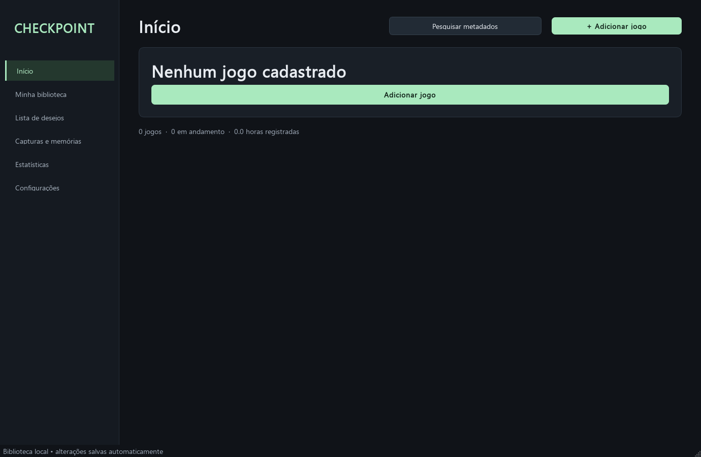
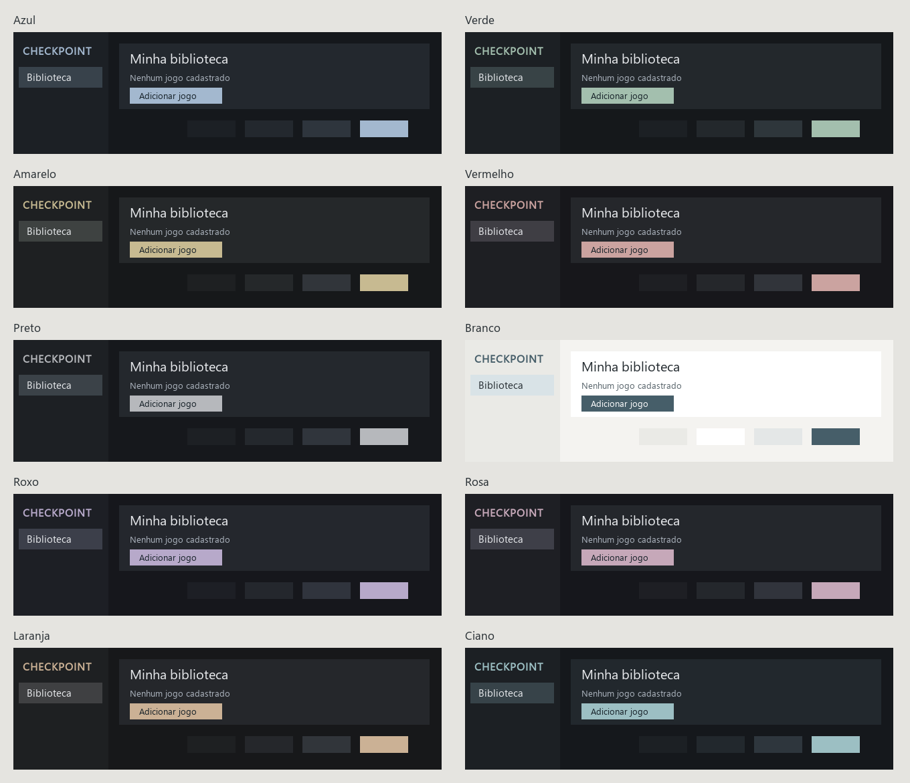

# Checkpoint

Biblioteca pessoal de jogos para Windows em Python/PySide6 e SQLite. Versão **0.1.18 de desenvolvimento**.

Interface renovada: Início com atividade pessoal, biblioteca com capas inteiras, ficha com banner/logo e abas, cadastro simples e Configurações compactas. Identidade checkpo//nt e dez temas adaptáveis. Salvar continua gravando o jogo imediatamente, com ficha/imagens em segundo plano. Pacote Windows 0.1.18 ainda pendente de publicação.

Já oferece biblioteca manual persistente, galeria 3:4 e lista, pesquisa e filtros, favoritos, edição, lixeira recuperável, páginas de jogos, diário, mídia referenciada, conquistas pessoais, estatísticas de sessões confirmadas, metas de compra e backup/restauração local de saves explicitamente selecionados.

Há fluxos de integração implementados para pesquisa RAWG, artes SteamGridDB e ROMs no Google Drive. OAuth e leitura real do Drive, pesquisa/títulos e obtenção dos três tipos de arte SteamGridDB foram validados. RAWG autenticado permanece pendente. O scanner não baixa ROMs; downloads acontecem apenas por solicitação. Nenhuma função remove arquivos no Drive.

Steam: Configurações > Steam permite consultar a biblioteca, selecionar jogos para importar ou associar a cadastros existentes e consultar conquistas por jogo. Horas Steam ficam separadas das sessões locais. Requer chave Steam Web API e SteamID64; validação autenticada de conta Steam permanece separada dos testes controlados.

Para continuar o desenvolvimento em outro dispositivo, leia [Continuidade](CONTINUITY.md),
[Visão do produto](PRODUCT_VISION.md) e [Codex Cloud](CLOUD_SETUP.md). Código e documentação
no branch padrão permitem reconstruir o ambiente; dados pessoais e credenciais ficam separados.

## Executar

No ambiente de desenvolvimento, instale o projeto conforme SETUP.md e execute:

```powershell
python -m gamevault.app
```

O pacote portátil, quando gerado, fica em `dist/Checkpoint/Checkpoint.exe`. A pasta inteira `dist/Checkpoint` é necessária; não mova apenas o executável. Dados ficam em `%LOCALAPPDATA%/GameVault`, separados do programa. Para testar sem tocar na biblioteca principal:

```powershell
python -m gamevault.app --data-dir ./dados-isolados
```

## Documentação

- [Estado e limitações](PROJECT_STATUS.md)
- [Instalação e build](SETUP.md)
- [Arquitetura](ARCHITECTURE.md)
- [Plano de evolução](ROADMAP.md)
- [Integrações e credenciais](INTEGRATIONS.md)
- [Testes](TESTING.md)
- [Alterações](CHANGELOG.md)

O primeiro início é vazio. Dados de testes ficam em diretórios isolados e não são incluídos na biblioteca distribuída. Vídeos abrem no reprodutor padrão do Windows; imagens possuem visualização ampliada no aplicativo.



## Atualização 0.1.5 — Checkpoint

Nome visível e executável alterados para Checkpoint. Removidos slogans da navegação, do início e dos estados vazios. Os dados, a trava de instância e o cofre continuam usando os identificadores internos GameVault para abrir a biblioteca existente sem migração. O pacote Python e a pasta de fontes também permanecem com seus nomes internos. O usuário confirmou que os fluxos locais solicitados no teste anterior funcionaram; isso não valida integrações autenticadas.

## Temas de cores

Escolha entre Azul, Verde, Amarelo, Vermelho, Preto, Branco, Roxo, Rosa, Laranja e Ciano em Configurações > Aparência > Tema. A preferência é salva e aplicada imediatamente.


